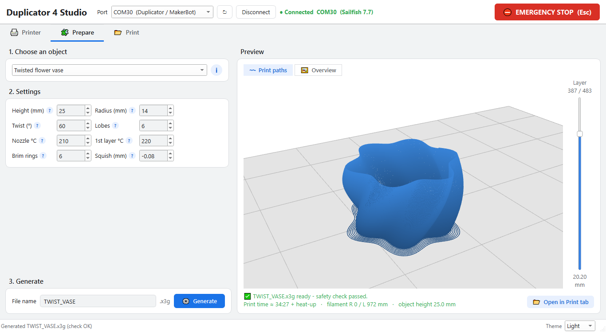
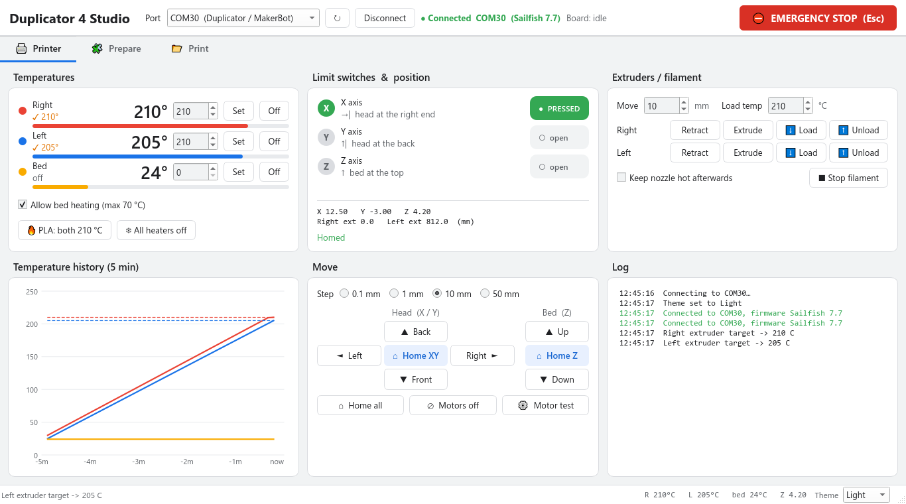
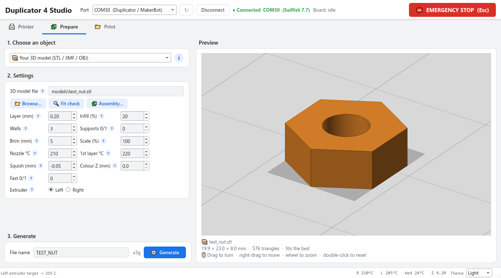
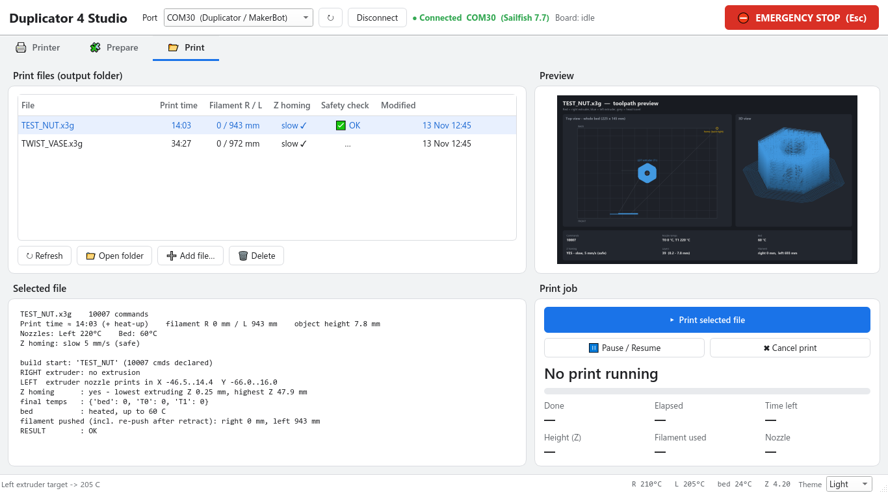
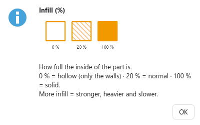
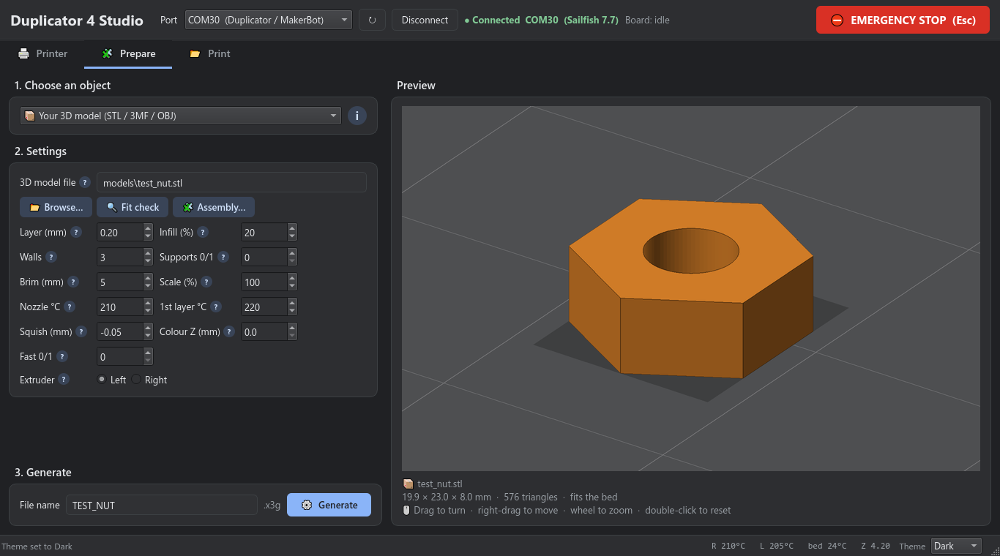
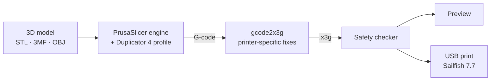

<div align="center">

# 🖨️ Duplicator 4 Studio: Wanhao Duplicator 4 Software

**Wanhao Duplicator 4 software for Windows: a Duplicator 4 slicer, printer control and USB printing in one modern app.**

Open any 3D model (STL, 3MF, OBJ), slice it with the PrusaSlicer engine and print it over USB as
**Sailfish x3g**, with every quirk of this dual-extruder printer handled automatically.
Built and tested on the **Wanhao Duplicator 4**. The **Duplicator 4S** and other
**MakerBot Replicator 1 Dual** clones use the same Sailfish x3g system.


-41CD52?logo=qt&logoColor=white)


**[⬇ Download the latest release](https://github.com/arunranga247/Wanhao-Duplicator-4/releases/latest)**



</div>

---

## Contents

- [Features](#-features)
- [Screenshots](#-screenshots)
- [How it works](#-how-it-works)
- [Requirements](#-requirements)
- [Installation](#-installation)
- [Your first print](#-your-first-print)
- [User guide](#-user-guide)
- [Printer-specific engineering](#-printer-specific-engineering)
- [Safety](#-safety)
- [Project structure](#-project-structure)
- [Building the executable](#-building-the-executable)
- [Command-line tools](#-command-line-tools)
- [Troubleshooting](#-troubleshooting)
- [Roadmap](#-roadmap)
- [Support me](#-support-me)
- [About](#-about)

---

## ✨ Features

| Feature | What it does |
|---|---|
| 📦 **Print any 3D model** | STL, 3MF, OBJ and AMF are sliced by the PrusaSlicer engine with a tuned Duplicator 4 PLA profile: walls, solid top and bottom, infill, brim and optional supports |
| 🧊 **3D model viewer** | See your model on the Duplicator 4 bed before slicing: drag to turn, right-drag to move, wheel to zoom. Runs on the graphics card (smooth even with 200 000 triangles), with an automatic fallback for PCs without OpenGL |
| 〰️ **3D print-path preview** | After slicing, the real print moves in 3D (red = right nozzle, blue = left) with a **layer slider** to step through the print layer by layer |
| ❔ **Help on every setting** | A small **?** next to Layer, Infill, Walls, Supports, Brim, Squish and the rest: hover for a little drawing and a plain explanation |
| 🔍 **Fit check** | Before printing: does it fit, is it watertight, overhangs, thin walls, narrow gaps, and do assembled parts collide (3D report in the browser) |
| 🧩 **Built-in demo prints** | Twisted flower vase (spiral "vase mode"), square blocks, two-colour R+L cubes, left-extruder air demo |
| ✅ **Safety check on every file** | Bed limits, nozzle height, extruder speed, heated-bed and tool-change rules, checked before anything is printed |
| 🖨️ **Live printer control** | Temperatures with history chart, limit switches, move and home pad, filament load/unload, motor test |
| 📡 **USB printing** | Progress, time left, current height, filament used and nozzle temperatures, with pause and cancel |
| ⛔ **Emergency stop** | One click (or **Esc**) stops all motion and switches every heater off |
| 🎨 **Modern interface** | Qt 6 window, Google Material colours, **light / dark theme switches instantly**, one clear font everywhere, resizable |
| 💾 **Remembers your settings** | Tab, temperatures, per-object settings, window size and last file |
| 📦 **Single .exe** | Double-click to run; a built-in self-test confirms the installation |

---

## 📸 Screenshots

| Printer | Prepare | Print |
|---|---|---|
|  |  |  |
| Temperatures, limit switches, move pad, extruders | Choose a model or demo, see it in 3D, set it up and slice | File library, checklist, live print progress |

| 3D print paths | Help on every setting | Dark theme |
|---|---|---|
|  |  |  |
| The sliced print in 3D, layer by layer | Small **?** signs explain each setting | Light, dark or follow Windows - switches instantly |

---

## 🔄 How it works



1. **Slice:** PrusaSlicer turns the model into layers and toolpaths (walls, infill, supports, brim, speeds, cooling).
2. **Convert:** `gcode2x3g` writes the printer's binary **x3g** format and adds this printer's fixes (see [Printer-specific engineering](#-printer-specific-engineering)).
3. **Check:** every move is verified against the bed limits and the printer's rules. Unsafe files cannot be printed.
4. **Print:** the file is streamed over USB with live progress and an emergency stop.

---

## 📋 Requirements

| Item | Requirement |
|---|---|
| Printer | Wanhao Duplicator 4 (Replicator 1 Dual class), Sailfish 7.x firmware, USB connection |
| Computer | Windows 10 or 11 |
| Material | PLA, 1.75 mm |
| To run the .exe | Nothing else, apart from the PrusaSlicer engine in `engine/` |
| To run from source or build the .exe | Python 3.12+ and the packages in [`requirements.txt`](requirements.txt) |

---

## 🚀 Installation

### 1. Get the project

**Easiest:** download **Duplicator4Studio.exe** (v2.0.0) from the
[latest release](https://github.com/arunranga247/Wanhao-Duplicator-4/releases/latest) and extract it.
Put it in a folder of its own and add the PrusaSlicer engine next to it (step 2).

**Or** clone the source:

```powershell
git clone https://github.com/arunranga247/Wanhao-Duplicator-4.git
cd Wanhao-Duplicator-4
```

### 2. Add the slicing engine

PrusaSlicer is third-party and too large for GitHub, so download it once:

1. Download **`PrusaSlicer-2.9.6.zip`** (Windows portable) from the
   [PrusaSlicer 2.9.6 release](https://github.com/prusa3d/PrusaSlicer/releases/tag/version_2.9.6).
2. Optional, but recommended: check the download is genuine:
   ```powershell
   (Get-FileHash .\PrusaSlicer-2.9.6.zip -Algorithm SHA256).Hash
   # 5AAF22E42F95ACCECFA122D23A835911F289ECC2FF606DB3E83D637DDCC0A209
   ```
3. Extract it so this file exists: `engine\PrusaSlicer-2.9.6\prusa-slicer-console.exe`

> The app also finds PrusaSlicer in an `engine` folder next to the .exe, or in a normal installation
> under `C:\Program Files\Prusa3D\PrusaSlicer\`.

### 3. Python packages (only to run from source or build the .exe)

```powershell
python -m pip install --user -r requirements.txt
```

### 4. Connect the printer

Windows installs the USB driver automatically. The printer appears in Device Manager as
**USB Serial Device (COMxx)**, hardware ID `USB\VID_23C1&PID_D314`.

### 5. Verify

```powershell
.\Duplicator4Studio.exe --selftest
```

The result is written to `output\selftest.txt` in the app's data folder. The last line must be
**OVERALL: PASS**.

| You run | Data folder (print files, settings, logs) |
|---|---|
| The release download (.exe) | `Documents\Duplicator4Studio\` |
| A clone of this repository | The repository folder itself |

### Start the app

| Way | How to start it |
|---|---|
| Executable | Double-click **`Duplicator4Studio.exe`** (or a desktop shortcut to it) |
| From source | `D4_Control.bat` or `pythonw tools\d4_qt.py` |

> The first time you start a new .exe, Windows may show *"Windows protected your PC"* because the
> file is not code-signed. Click **More info → Run anyway**.

---

## 🎯 Your first print

1. Prepare the bed: clean it, then apply a thin layer of **glue stick** (or blue painter's tape).
2. Load PLA into the left extruder: **Printer → ⬇ Load** (Left).
3. **Prepare → 📦 Your 3D model → 📂 Browse…** → `models\test_nut.stl` → **⚙ Generate**.
4. **📂 Open in Print tab → ▶ Print selected file** → tick the checklist.
5. Watch the first layer. The print takes about 14 minutes plus heat-up.

---

## 📖 User guide

### Printer tab
- **Temperatures:** Set/Off per heater, the *PLA: both 210 °C* preset and *All heaters off*. Bars fill toward the target, and a 5-minute chart is shown below.
- **Limit switches:** X / Y / Z badges with **● PRESSED** / **○ open**, plus the current position.
- **Move:** arrows move the head (◄ ► ▲ ▼), **⌂ Home XY** is in the centre, the **Bed (Z)** column moves the bed (▲ Up = toward the nozzles), and the step is 0.1 / 1 / 10 / 50 mm.
- **Extruders:** Retract, Extrude, ⬇ Load and ⬆ Unload per extruder; **■ Stop filament** stops a load or unload.

### Prepare tab
- **1. Choose an object:** your own 3D model or a built-in demo. The small **i** button explains the object.
- **2. Settings:** every setting has a small **?** - hover for a little drawing and a plain explanation, click for the same in a box.
- **Preview:** up to three views, switched with the buttons above it:
  **🧊 3D model** (before slicing), **〰 Print paths** (after slicing: the real moves in 3D, with a **layer slider**) and **🖼 Overview** (bed top view + facts).
  Drag to turn, right-drag to move, mouse wheel to zoom, double-click to reset the view.
- **🔍 Fit check / 🧩 Assembly…:** checks a model (or several parts that fit together) before you print and opens a 3D report.

#### 3D model settings

| Setting | Meaning | Default |
|---|---|---|
| Layer (mm) | 0.1 fine · 0.2 normal · 0.3 draft | 0.2 |
| Infill (%) | inside fill density | 20 |
| Walls | number of outlines | 3 |
| Supports 0/1/2 | 0 = none · 1 = tree (organic) supports, the standard · 2 = straight pillars | 0 |
| Brim (mm) | first-layer rim for grip | 5 |
| Scale (%) | resize the model | 100 |
| Nozzle °C / 1st layer °C | PLA temperatures | 210 / 220 |
| Squish (mm) | first layer closer (negative) or further (positive) | −0.05 |
| Colour Z (mm) | above this height the other extruder prints (two colours, 0 = off) | 0 |
| Fast 0/1 | about 40 % quicker for simple parts | 0 |
| Extruder | Left or Right | Left |

### Print tab
The file library shows each file's print time, filament, Z-homing type and safety status. **▶ Print selected
file** opens a checklist, then shows live progress. Keep the app open and the PC awake while printing.

> **Tip:** press **Ctrl + Shift + A** for *About*. The theme (System / Light / Dark) is in the bottom-right corner
> and switches instantly. Settings are stored in `tools\d4_settings.json`; delete that file to reset them.

---

## 🔧 Printer-specific engineering

This Duplicator 4 was analysed over USB. Its faults and firmware quirks are handled in software:

| Finding | Solution in Duplicator 4 Studio |
|---|---|
| Heated-bed thermistor wire has failed before (then reads below room temperature) | Bed limited to 70 °C; bed heating (by hand or from a file) is refused while the sensor reads below 15 °C; the watchdog switches the bed off on over-temperature, sudden jumps or no rise |
| Fast Z homing caused controller resets | Slow Z homing (5 mm/s, 40 s limit) with heaters off; heat-up only after homing succeeds |
| Stored T1 (left nozzle) offset is wrong (~228 mm) | The firmware is never switched to T1; the 33 mm nozzle spacing is applied in software |
| Extruder direction inverted (negative steps feed filament) | One global direction constant used by every tool |
| No part-cooling fan | The slicer slows down small layers so they can cool |
| Very short slicer moves could over-speed the extruder | Extruder speed limited to 25 mm/s on every move |
| Empty nozzle for the first seconds of a print | 5 s settle, retract recovery, purge blob and double prime line |

---

## 🔒 Safety

- **⛔ Emergency stop** (button or **Esc**): halts motion, clears the printer's buffer and switches all heaters off.
- **Heater watchdog:** switches all heaters off if a sensor reads implausibly low, a heater does not warm up in time, or the bed overheats or its reading jumps.
- **Bed heating:** maximum 70 °C, *Allow bed heating* switch, and refused automatically while the bed sensor reads below 15 °C (broken wire) - when you set it by hand **and** when a file wants to heat the bed.
- **No accidental changes:** number boxes ignore the mouse wheel until clicked, so scrolling the page never changes a temperature.
- **Safety checker:** files that leave the bed, dig into it, over-speed an axis, heat the bed or use the faulty T1 offset are refused.
- **Pre-print checklist** before every job.
- **Crash log:** unexpected errors are written to `output\crash_log.txt` and shown on screen. Closing the app releases the USB port first.

---

## 📁 Project structure

```
Wanhao-Duplicator-4/
├─ Duplicator4Studio.exe      the app (single file)
├─ D4_Control.bat             start from source
├─ requirements.txt
├─ engine/
│  ├─ duplicator4_pla.ini     Duplicator 4 PLA slicing profile
│  └─ PrusaSlicer-2.9.6/      slicing engine (download, not in git)
├─ models/                    test models (test_nut.stl, test_step_tower.stl); your own models stay local
├─ output/                    print files (.x3g / .gcode), logs, previews (not in git)
├─ designs/                   your own object design scripts (not in git, not in the app)
├─ docs/images/               screenshots
└─ tools/
   ├─ d4_qt.py                application window and tabs (Qt), 3D viewers
   ├─ d4_core.py              settings, help texts and every safety rule (tested)
   ├─ d4_gui.py               old Tk window (kept for reference, not in the .exe)
   ├─ d4_worker.py            USB connection thread, heater watchdog
   ├─ model_preview.py        3D model loading and CPU picture renderer
   ├─ fit_check.py            fit check + 3D report
   ├─ level_bed.py            bed levelling helper
   ├─ resume_print.py         continue a stopped print from a height
   ├─ d4_paths.py             folders, engine lookup, tool runner
   ├─ s3g_link.py             s3g/x3g protocol and printer constants
   ├─ slice_model.py          3D model → PrusaSlicer → x3g
   ├─ gcode2x3g.py            G-code → x3g with printer fixes
   ├─ make_dual_sample.py     x3g writer, squares and R+L cubes
   ├─ make_vase.py            twisted flower vase
   ├─ make_left_demo.py       left-extruder air demo
   ├─ check_x3g.py            safety checker
   ├─ render_preview.py       toolpath previews
   ├─ stream_x3g.py           command-line USB printing
   ├─ check_nozzle.py         heater and extruder test
   ├─ make_test_stl.py        test model generator
   ├─ build_exe.py            builds Duplicator4Studio.exe
   └─ tests/                  automatic tests (safety rules + the whole window, no printer needed)
```

---

## 🔨 Building the executable

```powershell
python -m unittest discover -s tools\tests   # 110 tests, about 3 minutes, no printer needed
python tools\build_exe.py                     # writes Duplicator4Studio.exe (about 63 MB)
.\Duplicator4Studio.exe --selftest            # must end with OVERALL: PASS
```

The build packs the app, all tools, Qt and the Duplicator 4 profile into one file, and sets the
Windows file properties (product, version, copyright). The PrusaSlicer engine stays in `engine/`.
The tests use a pretend printer and temporary folders, so they never move your printer or touch your files.

---

## 💻 Command-line tools

```powershell
cd tools
python slice_model.py --model ..\models\test_nut.stl --name NUT --only left
python check_x3g.py ..\output\NUT.x3g
python render_preview.py ..\output\NUT.x3g
python stream_x3g.py ..\output\NUT.x3g --port COM30     # close the app first
python check_nozzle.py --tool right
python make_vase.py --height 35 --twist 120 --lobes 8
```

---

## 🩺 Troubleshooting

| Problem | Solution |
|---|---|
| App shows **Disconnected** | Check power and USB. The app reconnects by itself every 3 s; check Device Manager for *USB Serial Device*. |
| *PrusaSlicer engine not found* | Extract PrusaSlicer into `engine\` ([Installation step 2](#2-add-the-slicing-engine)) |
| *Objects are outside of the print volume* | The model is larger than 225 × 145 × 140 mm. Reduce **Scale (%)**. |
| First layer does not stick | Clean the bed, use tape or glue, level the bed, set **Squish** to −0.10 and use a larger **Brim** |
| Nozzle scrapes, or little plastic comes out | Set **Squish** to 0 or +0.05 and level the bed |
| No plastic at all | Load the filament (⬇ Load) and check the extruder lever is closed |
| Printer disconnects during homing | Check the bed cables and the Z switch for pinched or loose wires |
| Window blank or app will not start | See `output\crash_log.txt`, then restart the app |
| 3D preview looks plain or slow | The PC has no usable OpenGL (e.g. remote desktop): the app switches to its built-in CPU viewer automatically. Updating the graphics driver brings back the fast 3D view. |
| Two app windows open | Only one can use the printer's USB port: close the other one |

---

## 🧭 Roadmap

- [ ] Assisted bed-levelling wizard (four corners plus centre)
- [ ] Re-enable bed heating after the thermistor is replaced
- [ ] Two-colour printing from multi-part 3MF models
- [ ] Print from SD card (send x3g to the printer's card over USB)

---

## 💖 Support me

If Duplicator 4 Studio brought your printer back to life or saved you time, here is how you can help:

<p>
<a href="https://github.com/arunranga247/Wanhao-Duplicator-4"></a>
<a href="https://github.com/arunranga247"></a>
</p>

| Way to help | How |
|---|---|
| ⭐ **Star the repository** | Click **Star** at the top of the [repository page](https://github.com/arunranga247/Wanhao-Duplicator-4). It helps other Duplicator 4 owners find the project. |
| 🐛 **Report a bug or suggest an idea** | Open an [issue](https://github.com/arunranga247/Wanhao-Duplicator-4/issues/new) with your printer, firmware version and what happened |
| 🔧 **Contribute** | Fork the repository, make your improvement and open a pull request |
| 📢 **Share it** | Tell other Wanhao Duplicator 4 and MakerBot Replicator owners about it, in forums, groups and makerspaces |
| 🖨️ **Show your prints** | Post a photo of something you printed with Duplicator 4 Studio in an issue or discussion |

Every star, report and share keeps this project growing. **Thank you!**

---

## 👤 About

<table>
<tr>
<td width="120" align="center">
<br>
</td>
<td>

**Duplicator 4 Studio** was designed and developed by **ARUN**.

It brings a reliable, modern workflow to the Wanhao Duplicator 4, from 3D model to finished part, by
combining a proven slicing engine with software written specifically for this printer and its hardware.

- GitHub: [arunranga247](https://github.com/arunranga247)
- Repository: [Wanhao-Duplicator-4](https://github.com/arunranga247/Wanhao-Duplicator-4)

</td>
</tr>
</table>

### Acknowledgements

Duplicator 4 Studio uses these open-source projects:

- [PrusaSlicer](https://github.com/prusa3d/PrusaSlicer): slicing engine (AGPL-3.0), used as a separate program
- [Qt for Python (PySide6)](https://doc.qt.io/qtforpython-6/): the app window and 3D viewers (LGPL-3.0)
- [NumPy](https://numpy.org/) and [Manifold](https://github.com/elalish/manifold): 3D model maths and fit check
- [three.js](https://threejs.org/): 3D fit-check report in the browser (MIT)
- [pySerial](https://github.com/pyserial/pyserial): USB serial communication
- [Pillow](https://github.com/python-pillow/Pillow): images and previews
- [PyInstaller](https://github.com/pyinstaller/pyinstaller): single-file executable

### Licence

Copyright © 2026 **ARUN**.

Duplicator 4 Studio is free software: you can redistribute it and/or modify it under the terms of the
**GNU General Public License v3.0** as published by the Free Software Foundation. See [`LICENSE`](LICENSE).

This program is distributed in the hope that it will be useful, but **WITHOUT ANY WARRANTY**; without even
the implied warranty of MERCHANTABILITY or FITNESS FOR A PARTICULAR PURPOSE. 3D printers have hot parts and
moving axes: never leave a printer unattended, and use this software at your own risk.

Third-party components keep their own licences: see [`THIRD_PARTY_NOTICES.md`](THIRD_PARTY_NOTICES.md)
and the [`licenses/`](licenses) folder. The PrusaSlicer engine (AGPL-3.0) is a separate program that you
download yourself; it is not part of this repository or of the .exe.

### Trademarks

*Wanhao* and *Duplicator* are trademarks of Wanhao; *MakerBot* and *Replicator* are trademarks of MakerBot
Industries; *Sailfish* is the open-source firmware by its authors. They are named only to say which
printers and firmware this software works with. Duplicator 4 Studio is an independent project and is **not
affiliated with or endorsed by** any of them. It contains no code from Sailfish, GPX, ReplicatorG or
MakerBot software.

<div align="center">
<sub>Made for the Wanhao Duplicator 4 · Sailfish firmware · Windows</sub>
</div>
